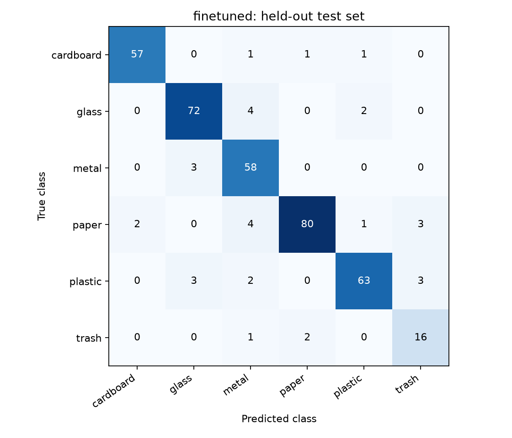
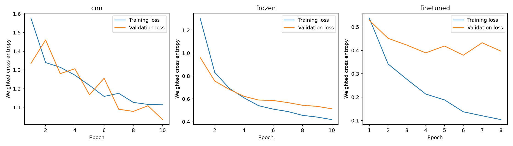

# VisionGuard

**Waste image classification with reproducible transfer learning and honest evaluation.**

[](https://github.com/AryaShah800/visionguard/actions/workflows/tests.yml)

| Model | Result on 379 held-out TrashNet images |
| --- | --- |
| Fine-tuned MobileNetV2 (selected) | 89.75% macro-F1 (single seed) |
| Frozen MobileNetV2 | 80.85% macro-F1 |
| Small CNN from scratch | 63.23% macro-F1 |

VisionGuard compares a small CNN trained from scratch, an ImageNet-pretrained MobileNetV2 with a frozen backbone, and a partially fine-tuned MobileNetV2. It predicts one of six TrashNet categories: cardboard, glass, metal, paper, plastic and trash.

The final model is selected using validation macro-F1. A separate command evaluates the held-out test set and produces a comparison table, confusion matrix, training curves, error gallery and latency measurements. A local Streamlit app lets you explore predictions and measured results.

## Quick start on Windows

Use Python 3.11–3.13. Run commands from this directory. An isolated environment is already installed on the development laptop.

```powershell
# For a fresh checkout (system pip supplies the environment installer):
python -m venv --without-pip .venv

# NVIDIA GPU with a compatible CUDA 12.8 driver:
python -m pip --python .venv\Scripts\python.exe install torch==2.7.1 torchvision==0.22.1 --index-url https://download.pytorch.org/whl/cu128

# Then install the remaining dependencies:
python -m pip --python .venv\Scripts\python.exe install -r requirements.txt
```

For CPU-only machines, substitute `https://download.pytorch.org/whl/cpu` for the CUDA package index. The training code selects CUDA when available and otherwise uses CPU. The exact development environment is recorded in `requirements-lock.txt`; CUDA-specific builds require the matching PyTorch package index when restoring the lock file.

```powershell
.\.venv\Scripts\python -m vg download
.\.venv\Scripts\python -m vg prepare
.\.venv\Scripts\python -m vg train --device auto --run runs/baseline
.\.venv\Scripts\python -m vg evaluate --run runs/baseline
.\.venv\Scripts\python -m vg predict data/dataset-resized/plastic/plastic1.jpg
.\.venv\Scripts\python -m streamlit run app.py
```

Open the local URL printed by Streamlit. You can also run `launch.ps1` from PowerShell. For an existing trained workspace, start at the demo command. Do not repeat `prepare`, `train`, or `evaluate` over existing outputs: they deliberately reject overwrites. Use a new manifest/run path for a new planned experiment.

The first pretrained training run downloads official MobileNetV2 weights into `data/torch-cache`. Prediction does not need network access once the experiment checkpoint exists.

## Results and evidence

See [the measured results](reports/REPORT.md) and [aggregate metrics](reports/metrics.json). Full local artifacts are in `runs/baseline/`:

| Artifact | Purpose |
|---|---|
| `config.json` | Seeds, versions, hardware, learning rates and augmentation |
| `selection.json` | Validation comparison, chosen model and checkpoint hashes |
| `cnn.pt`, `frozen.pt`, `finetuned.pt` | Best validation checkpoint per model |
| `*-history.json` | Epoch-level losses, validation scores and timings |
| `evaluation/` | Held-out test predictions, figures, metrics and report |

One complete seed is the default experiment. The CLI supports additional seeds in separate run directories; choose configurations and the final model using validation only, before running final test evaluation. Do not pick a model based on whichever test score is highest.

## Data integrity

The original TrashNet archive contains 2,527 images. The audited run retained 2,521 after excluding six images in three exact-pixel duplicate groups with conflicting labels. It detected 25 perceptual-hash candidate pairs and kept each connected group within one partition.

The saved manifest has **1,763 training, 379 validation and 379 test images**. It stores relative paths, labels, file hashes, pixel hashes and group IDs. File hashes are verified before training and evaluation. Group-aware splitting searches only for balanced class counts; it does not use model performance.

Augmentation runs only on training images. Validation/test use deterministic preprocessing from `MobileNet_V2_Weights.IMAGENET1K_V2`: resize to 232, center crop to 224 and ImageNet normalization. The frozen backbone stays in evaluation mode to preserve BatchNorm statistics. Fine-tuning unfreezes feature blocks 14 onward and the classification head.

Physical-item IDs are unavailable for most benchmark images. Perceptual grouping reduces leakage but cannot guarantee all photos of the same item have been identified. To supply known IDs, pass `--groups item_groups.csv` to `prepare`; CSV columns are `path,item_id`. Save a new manifest before training.

## Independent phone-photo evaluation

**Pending collection; no independent-photo performance is claimed.** The implementation supports locking and evaluating this set, but benchmark images are not substitutes for photos you collect yourself.

Follow [the collection guide](docs/PHONE_PHOTO_COLLECTION.md), then run:

```powershell
.\.venv\Scripts\python -m vg lock-challenge --images data/phone-photos
.\.venv\Scripts\python -m vg evaluate-challenge --images data/phone-photos --run runs/baseline
```

The lock step rejects exact duplicates and likely benchmark overlaps. The evaluation verifies locked image hashes and reports separate macro-F1, per-class metrics and the change from benchmark performance. A threshold selected on benchmark validation is reused unchanged.

## Scores and uncertainty

The app shows top-three softmax scores, not calibrated correctness probabilities. If validation supports at least 90% accepted accuracy at 50% or greater coverage, the lowest qualifying score threshold is saved. Otherwise selective prediction is disabled. Coverage and accepted accuracy are reported on the test set. This is an empirical validation rule, not a guaranteed error rate or an unknown-object detector.

## Tests

```powershell
.\.venv\Scripts\python -m pytest tests -q --basetemp=.test-temp
```

Tests cover group leakage, deterministic transforms, changed data, frozen BatchNorm and gradients, fine-tuning boundaries, checkpoint round trips, prediction validation, uncertainty selection and challenge validation. Synthetic fixtures are software tests only. Benchmark scores come from the actual TrashNet experiment.

## Project layout

```text
vg/data.py       download, image audit, duplicate grouping, locked partitions
vg/models.py     small CNN, frozen/fine-tuned MobileNetV2, checkpoint loading
vg/train.py      seeded training, early stopping, validation model selection
vg/evaluate.py   held-out comparison, figures, errors and latency
vg/predict.py    shared local inference used by the CLI and app
vg/challenge.py  independent-photo lock and evaluation
app.py          local Streamlit demo
tests/          correctness and integration checks
docs/           phone-photo collection guide
reports/        portable, measured experiment evidence
```

## Results at a glance




## Limitations

This is a small, historical single-item dataset with mostly simple backgrounds. It does not establish reliable recycling advice, multi-object detection or recognition of unseen categories. The trash class is a dataset label, not a universal unknown class. Results from one random seed have sampling and training uncertainty, especially for the 19 trash images in the test set. Hardware and package changes can alter training results despite seeded randomness. Local latency measurements exclude model loading and use warm caches.

## Attribution

Dataset: Gary Thung and Mindy Yang, [TrashNet](https://github.com/garythung/trashnet). Cite the source if redistributing derived image figures; the repository includes an MIT license. Downloaded images and weights are not committed with this project. See the source's current terms before redistributing raw datasets.

Training references: [PyTorch transfer learning tutorial](https://docs.pytorch.org/tutorials/beginner/transfer_learning_tutorial.html) and [Torchvision MobileNetV2](https://docs.pytorch.org/vision/stable/models/generated/torchvision.models.mobilenet_v2.html).

## License

MIT. See [LICENSE](LICENSE). TrashNet is credited under Attribution above.
