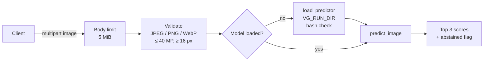

# Serving VisionGuard over HTTP

`vg/api.py` wraps the same inference code as the CLI and Streamlit app (`vg.predict.load_predictor` / `predict_image`) in a small FastAPI service. It serves the validation-selected checkpoint and re-verifies checkpoint hashes against `selection.json` when the model loads.

> **Verified 14 November 2026:** all 37 tests pass in the trained local project. The CPU Docker image builds, `/health` reports ready, and `/predict` classifies a synthetic image using the real selected checkpoint. Local service: `http://127.0.0.1:8001`. It is not published to Hugging Face; no public deployment or uptime is claimed.

## Tracking existing experiments

`scripts/track_existing.py` imports the measured CNN, frozen and fine-tuned experiments into local MLflow after checking checkpoint and manifest hashes. This is a historical-artifact import, not a training rerun. It records validation/test metrics, config, histories and model artifacts and reuses matching checkpoint runs. Install `requirements-tracking.txt` separately if needed, then run:

```powershell
python scripts/track_existing.py --run runs/baseline --tracking-uri sqlite:///mlflow.db
```

Three imports were verified locally. Their macro-F1 results remain 63.23%, 80.85% and 89.75%; no new training result is claimed.



## Endpoints

| Method | Path | Purpose |
| --- | --- | --- |
| `GET` | `/health` | Liveness plus readiness. Always `200`; read the `ready` field. Does not load the model |
| `POST` | `/predict` | Classify one uploaded image (form field `file`) |
| `GET` | `/docs` | Interactive OpenAPI page generated by FastAPI |

`GET /health`:

```json
{"status": "ok", "version": "0.2.0", "ready": true, "model_loaded": false, "model": null}
```

- `ready` is `true` once the model has loaded, or before that if `selection.json` exists in the run directory and no load has failed.
- `model_loaded` and `model` (`finetuned`, `frozen` or `cnn`) are filled after the first successful load.

`POST /predict` response shape (values here are placeholders, not measured output):

```json
{
  "prediction": "<top class>",
  "abstained": false,
  "top_three": [{"class": "<class>", "score": 0.0}, {"class": "<class>", "score": 0.0}, {"class": "<class>", "score": 0.0}],
  "threshold": 0.4,
  "model": "finetuned",
  "note": "Model scores are not calibrated correctness probabilities. One prominent item per photo."
}
```

- `abstained` is `true` when the top score is below the threshold saved at validation time (see *Scores and uncertainty* in the README). `prediction` still holds the top class; clients should show it as "uncertain, review manually" rather than as an answer.
- If validation did not support a threshold, `threshold` is `null` and `abstained` is always `false`.

### Input rules and errors

| Check | Response |
| --- | --- |
| Body over 5 MiB (by `Content-Length` or by counting streamed bytes) | `413` |
| Empty file | `400` |
| Declared type not JPEG/PNG/WebP (or `application/octet-stream`) | `415` |
| Content that is not really JPEG/PNG/WebP, or an animated PNG/WebP (multi-frame phone JPEGs are allowed; the first frame is used) | `415` |
| More than 40 megapixels (checked from the header, before decoding) | `413` |
| Smaller than 16 × 16 pixels | `422` |
| Corrupt or truncated image | `400` |
| Model missing or checkpoint hash mismatch | `503` |
| Anything unexpected | `500` with a generic message |

Error bodies are `{"detail": "<message>"}`. Messages never contain local file paths; the full traceback of a failed model load goes to the server log only.

## Configuration

| Variable | Default | Meaning |
| --- | --- | --- |
| `VG_RUN_DIR` | `runs/baseline` (falls back to `VISIONGUARD_RUN` if set) | Trained run directory with `selection.json` and `cnn.pt`, `frozen.pt`, `finetuned.pt`. Read when the model first loads, not at import |
| `VG_PRELOAD` | unset (lazy) | `1` loads the model at startup instead of on the first `/predict` |
| `PORT` | `7860` (Docker only) | Port uvicorn listens on inside the container |

All three checkpoints must be present: `verify_selection` checks the hash of every checkpoint recorded at selection time, not only the chosen one.

## Run locally (offline)

Prediction needs no network once the dependencies are installed and a trained run exists. From the repository root on Windows:

```powershell
# One-time, needs network. The development venv's CUDA torch 2.7.1 already satisfies the torch pin.
.\.venv\Scripts\python -m pip install -r requirements-api.txt

$env:VG_RUN_DIR = "runs\baseline"
.\.venv\Scripts\python -m uvicorn vg.api:app --host 127.0.0.1 --port 8000
```

In a second terminal:

```powershell
curl.exe http://127.0.0.1:8000/health
curl.exe -F "file=@data/dataset-resized/plastic/plastic1.jpg" http://127.0.0.1:8000/predict
```

`127.0.0.1` keeps the service on your machine. The training images in `data/` are only an example input; a prediction on a training image says nothing about generalization.

Run the API tests (synthetic images and a fake predictor; no checkpoint needed):

```powershell
.\.venv\Scripts\python -m pytest tests/test_api.py -q --basetemp=.test-temp
```

If FastAPI, httpx or python-multipart are missing, the API tests are skipped rather than failed. CI installs `requirements-api.txt`, so they run there.

## Docker (CPU)

The image installs CPU-only PyTorch, copies `vg/` and the three checkpoints plus `selection.json` into `/app/model`, runs as a non-root user (uid 1000) and listens on port 7860.

`.dockerignore` is an allowlist: only `vg/`, `requirements-api.txt`, `runs/baseline/selection.json` and the three `.pt` files enter the build context. `data/` (TrashNet images, manifests, phone photos), `.env`, `.venv`, `.git`, evaluation outputs and training history are excluded.

```powershell
# Needs Docker and network for the base image and packages; requires runs/baseline from a completed training run.
docker build -t visionguard-api .
docker run --rm -p 7860:7860 visionguard-api
curl.exe http://127.0.0.1:7860/health
```

To use a different run without rebuilding, mount it read-only and point `VG_RUN_DIR` at it:

```powershell
docker run --rm -p 7860:7860 -v "${PWD}\runs\other-run:/runs/other:ro" -e VG_RUN_DIR=/runs/other visionguard-api
```

Notes:

- The image sets `VG_PRELOAD=1`, so the model loads at startup and the first request is not slow. If loading fails, the container still starts and `/health` reports `"ready": false`.
- The Docker `HEALTHCHECK` only checks that `/health` answers (liveness). Use the `ready` field for readiness.
- One uvicorn worker: each worker would hold its own copy of the model.

## Deploying to Hugging Face Spaces (free CPU) — prepared, not deployed

The Space files are prepared (`space/README.md` with the Space metadata, `scripts/prepare_space.py` to assemble the folder) but nothing has been published. Publishing needs the owner's Hugging Face account:

0. `python scripts/prepare_space.py ../visionguard-space` assembles the upload folder (Dockerfile, `vg/`, checkpoints, Space README).

1. Create a **Docker** Space. In the Space's own `README.md` front matter set `sdk: docker` and `app_port: 7860`.
2. Push this Dockerfile, `.dockerignore`, `requirements-api.txt`, `vg/` and `runs/baseline/{selection.json,cnn.pt,frozen.pt,finetuned.pt}`. Checkpoints over 10 MB need Git LFS/Xet on the Hub.
3. Never push `data/`, `.env` or the training images. Check the TrashNet attribution in the README still applies to anything published.
4. After the Space builds, check `/health` reports `"ready": true` before linking it anywhere.

Free CPU Spaces sleep when idle, so the first request after a pause can be slow. Do not quote latency or uptime numbers until they have been measured on the deployed Space.
