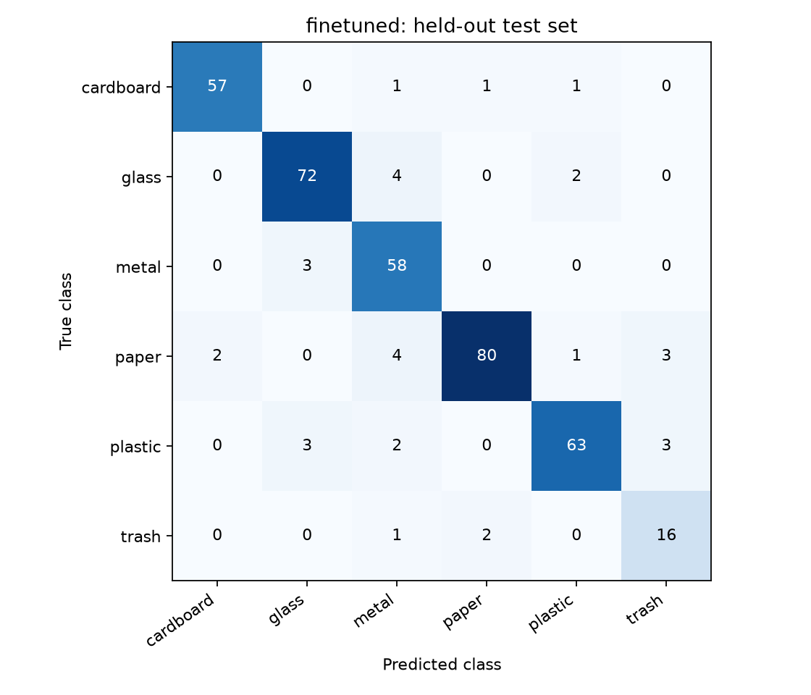
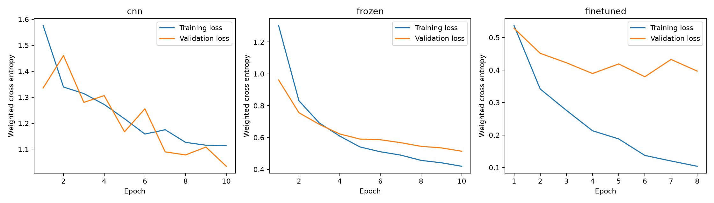
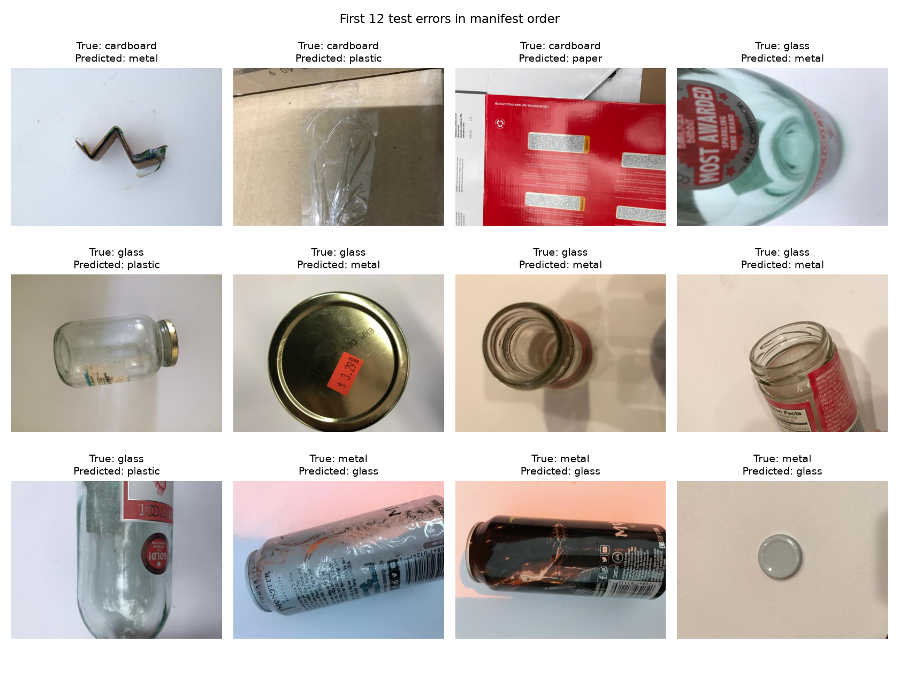

# VisionGuard measured results

Selected using validation macro-F1: **finetuned**.

| Model | Validation macro-F1 | Test macro-F1 | Test accuracy |
|---|---:|---:|---:|
| majority | 0.0622 | 0.0640 | 0.2375 |
| cnn | 0.6041 | 0.6323 | 0.6385 |
| frozen | 0.8406 | 0.8085 | 0.8443 |
| finetuned | 0.8839 | 0.8975 | 0.9129 |

Test images: 379. Single seed: 42.

Independent phone-photo evaluation: **not yet performed**.

Source images: Gary Thung and Mindy Yang, TrashNet.